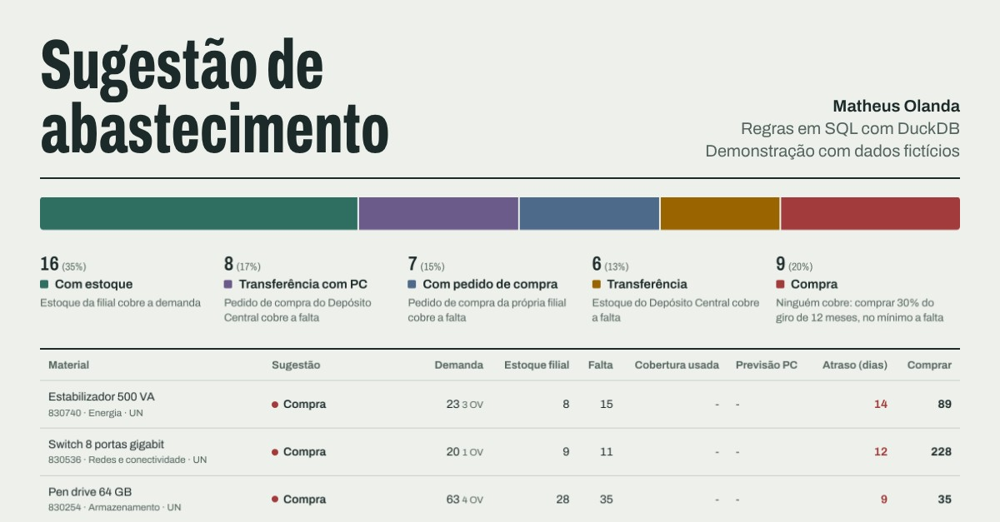
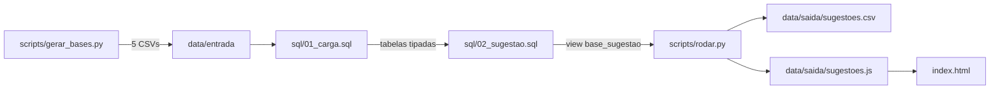

# replenishment-suggester

Regras de abastecimento em **SQL (DuckDB)** que decidem, para cada material com pedido de venda em aberto, de onde deve vir o atendimento: estoque da filial, transferência do depósito, pedido de compra em andamento ou compra nova.

[](https://olandamatheus.github.io/replenishment-suggester/)

**[Abrir a demonstração](https://olandamatheus.github.io/replenishment-suggester/)**

> Todos os dados são **fictícios**, gerados por script. Nenhuma empresa, cliente ou material real.

## O problema

Quem cuida do abastecimento de uma filial recebe todo dia a carteira de pedidos em aberto e precisa responder, item a item: comprar ou não comprar? Sem uma regra única, a mesma peça acaba sendo comprada pela filial enquanto o depósito central já tem estoque ou um pedido de compra chegando.

## A solução

Um processo em SQL que cruza quatro extrações (carteira, estoque, pedidos de compra e faturamento) e dá **uma sugestão por material**, testando as regras nesta ordem:

| Ordem | Sugestão | Quando |
|---|---|---|
| 1 | Com estoque | o estoque da filial cobre a demanda |
| 2 | Transferência com PC | um pedido de compra do Depósito Central cobre a falta |
| 3 | Com pedido de compra | um pedido de compra da própria filial cobre a falta |
| 4 | Transferência | o estoque do Depósito Central cobre a falta |
| 5 | Compra | nenhuma das anteriores |

**Por que o PC do depósito vem antes do PC da filial:** o depósito compra em volume e já abastece a filial na rota normal. Usar o pedido dele evita duas compras do mesmo item.

**Quantidade de compra:** 30% do faturamento dos últimos 12 meses fechados (cerca de 3,6 meses de giro), **nunca menos do que a falta** da carteira. Dois exemplos da base:

| Material | Falta | Giro 12 meses | Sugestão de compra | Motivo |
|---|---|---|---|---|
| Papel A4 75 g (caixa 10 resmas) | 5 | 324 | 98 | 30% do giro (97,2, arredondado para cima) |
| Fonte para notebook 65 W | 12 | 0 | 12 | sem giro, compra só a falta |

O fator de 30% fica na tabela `parametros`, fácil de ajustar à política de cada área.

## O que a página mostra

- Resumo em texto e totais em **contagem de materiais**. As unidades são diferentes (UN, CX, RL), então somar quantidades entre materiais não teria significado.
- Distribuição dos cinco tipos, que também funciona como filtro.
- **Alerta para a expedição:** materiais que têm estoque na filial e mesmo assim estão com a entrega vencida. Ali o gargalo é separação ou expedição, não compra.
- Tabela ordenada por prioridade (compras primeiro, depois o maior atraso), com busca sem acento, filtro por categoria e "só atrasados".

## Arquitetura



As extrações saem no formato típico de ERP: separador `;`, vírgula decimal, datas `dd.mm.aaaa` e códigos com zeros à esquerda. As mesmas regras de limpeza estão em Power Query no repositório [powerquery-patterns](https://github.com/OlandaMatheus/powerquery-patterns).

## Decisões técnicas

- **Tudo lido como texto e convertido no SQL** (`all_varchar`). Deixar o DuckDB adivinhar os tipos leria `000000000000830148` como número e `10,000` como texto.
- **Duplicidade da extração tratada com `QUALIFY ROW_NUMBER()`**: a carteira às vezes traz o mesmo item de pedido duas vezes, o que inflaria a demanda.
- **Estoque e PCs por centro com `SUM(...) FILTER (WHERE ...)`**: uma linha por material, sem `PIVOT` dinâmico.
- **Parâmetros em tabela, não em `SET VARIABLE`**: variável vale só na sessão, e a view quebraria ao reabrir o banco para uma consulta manual.
- **Data de corte fixa em vez de `CURRENT_DATE`**: o resultado bate com a extração mesmo se o processo rodar de novo outro dia.
- **CSV de saída escrito em Python, no padrão brasileiro**: o `COPY` do DuckDB não escreve vírgula decimal, e o Excel em pt-BR leria `12.000` como doze mil.

## Limitação conhecida

Cada fonte é testada sozinha contra a falta. Se nenhuma cobre tudo, mas a soma de duas cobriria (por exemplo, parte do estoque do depósito e parte de um PC), a sugestão é Compra. Combinar fontes é o próximo passo natural.

## Como rodar

```bash
pip install -r requirements.txt
python scripts/gerar_bases.py   # opcional: regera as bases fictícias
python scripts/rodar.py         # carga, regras e exportação
```

Depois, abra o `index.html` no navegador. O banco `sugestor.duckdb` fica disponível para consultas manuais:

```sql
SELECT sugestao, COUNT(*) AS materiais
FROM base_sugestao
GROUP BY sugestao
ORDER BY materiais DESC;
```

## Licença

MIT
